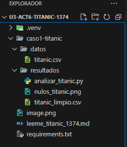
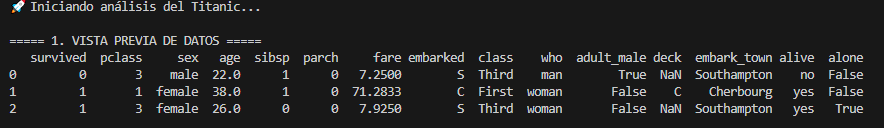
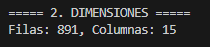
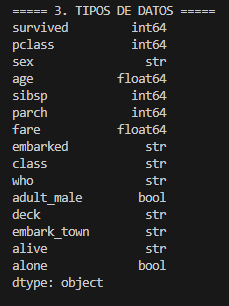
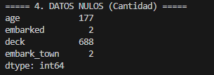
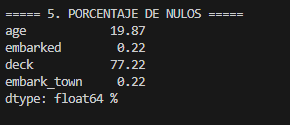
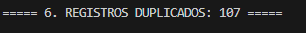
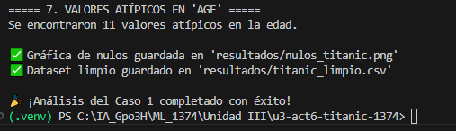
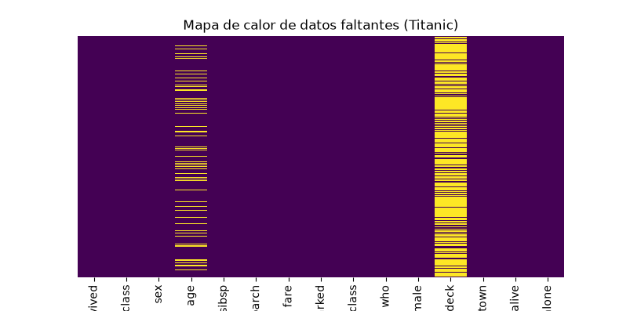

 🕵️‍♂️ Práctica: Identificación de Problemas en los Datos

> **⏱️ Duración:** 2 horas  
> **🎯 Nivel:** Cero a principiante  
> **🤖 Área:** Machine Learning (Data Cleaning)  
> **💻 Herramientas:** Python, VS Code, Pandas, NumPy, Seaborn 
# Cristopher lopez 1374 
## Titanic

## Estructura de carpetas 

# 1. VISTA PREVIA DE DATOS

# 2. DIMENSIONES 

# 3. tipos de datos 

# 4. Datos nulos 

# 5. PORCENTAJE DE NULOS 

# 6. REGISTROS DUPLICADOS 

# 7. valores atiícos en 'AGE'

# Grafica de Nulos titanic 

